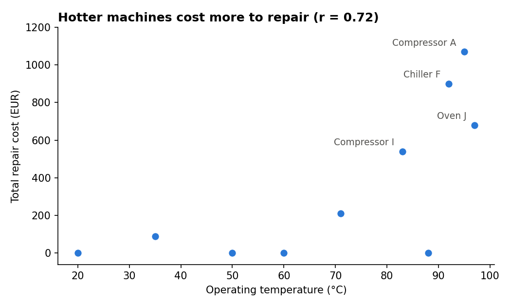
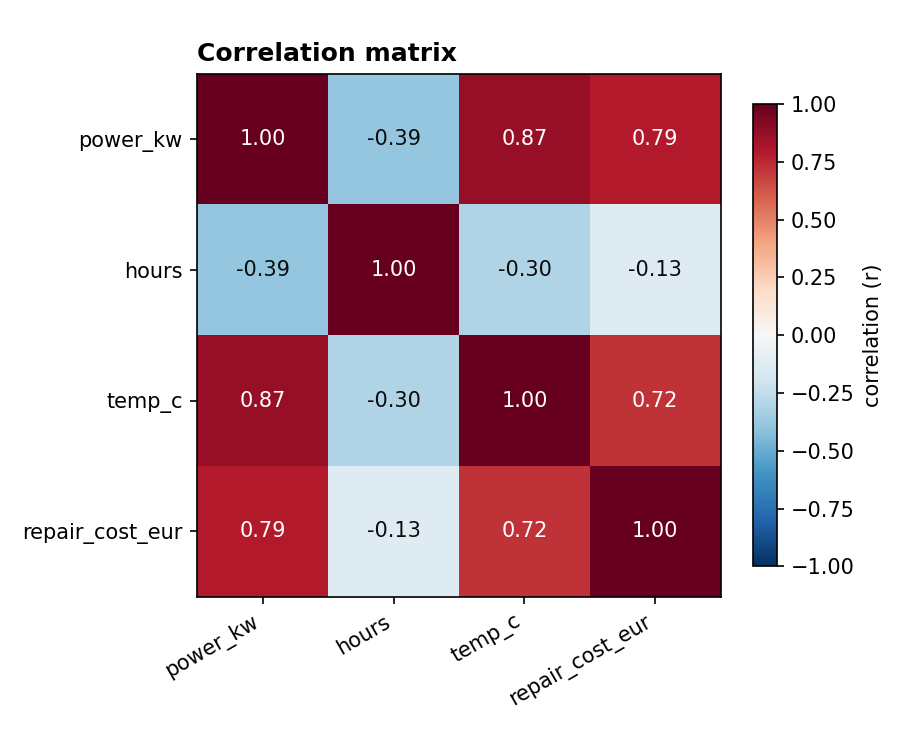
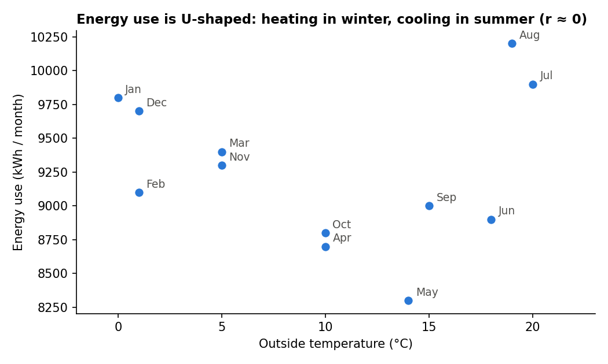
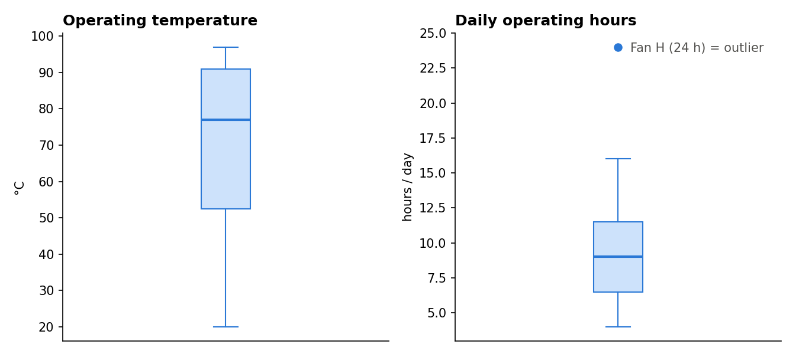

# 📊 Factory Statistics Analysis

**What is a typical machine in our factory, how different are the machines, and what drives repair and energy costs?**

This project applies descriptive statistics and correlation analysis in **Python (pandas, matplotlib)** to factory machine data, repair costs and monthly energy use.

**Skills:** mean vs median · outliers · standard deviation · quartiles & boxplots · correlation · correlation ≠ causation · data visualisation

---

## 🔑 Key findings

| # | Finding | Evidence |
|---|---|---|
| 1 | **Most machines run hot** | median 77 °C vs mean 69.1 °C (two cold fans pull the mean down) |
| 2 | **Outliers distort the mean** | one 5,000 EUR breakdown (what-if) doubles the mean repair cost (436 → 943 EUR); the median barely moves (415 → 450 EUR) |
| 3 | **Hot machines cost more to repair** | r = **0.72** between temperature and repair cost |
| 4 | **…but heat and size go together** | r = **0.87** between temperature and power: machine size may drive both (correlation ≠ causation) |
| 5 | **Running hours barely matter** | r = −0.13 between daily hours and repair cost |
| 6 | **Energy use is U-shaped** | r ≈ 0 with outside temperature, yet the plot shows peaks in winter (heating) and summer (cooling) |

---

## ✅ Conclusions

1. Report **medians** when data has outliers.
2. **Hot, powerful machines** are the main repair cost drivers, but more data is needed to separate the effect of heat from machine size.
3. **Always plot before trusting a correlation**: r ≈ 0 can hide a strong non-linear (U-shaped) relationship.
4. Plan energy capacity for **two seasonal peaks** (heating and cooling).

---

## 📁 Files

| File | Content |
|---|---|
| `Factory_Statistics_Analysis.ipynb` | Notebook with all code, results and insights |
| `factory.csv` | 10 machines: type, power_kw, hours, temp_c |
| `monthly_energy.csv` | monthly energy use (kWh) and approximate outside temperature (°C) |
| `*.png` | the 4 charts |

**Data:** a small sample dataset created for practice. Repair costs per machine come from my [SQL maintenance project](https://github.com/ayushramtekkar/Factory_maintenance_SQL). Outside temperatures are approximate Berlin monthly averages. The 5,000 EUR repair is a hypothetical scenario used to demonstrate the effect of outliers.

---

## 👤 About

**Ayush Ramtekkar**: M.Sc. student in AI / Data Science & Digital Business (Gisma, Berlin) with a B.E. in Mechanical Engineering. Looking for a **Werkstudent role in data analytics**, ideally in energy, cleantech or manufacturing.

📂 More projects:
- [Factory Energy Analysis (Python & pandas)](https://github.com/ayushramtekkar/Factory_Energy_Analysis)
- [Factory Maintenance Analysis (SQL)](https://github.com/ayushramtekkar/Factory_maintenance_SQL)
